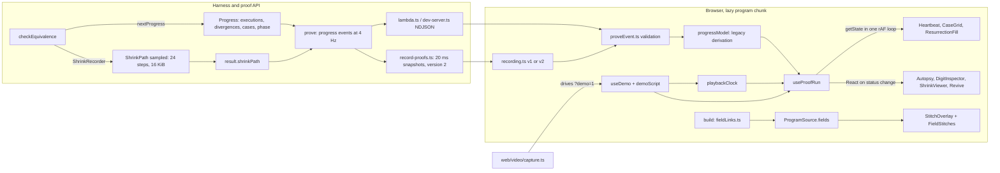

# Design Document

Graphical proof and demo mode (`graphical-proof`). Requirements: `requirements.md`
in this folder. Builds on `.kiro/specs/reanimation-lab/design.md`.

## Overview
Three layers change, in this order:

1. **Data.** The harness counts cases apart from shrink attempts and records
   the shrink path. Progress events, results and recordings carry the new
   data. Old clients and version 1 recordings keep working.
2. **Visuals.** New components in the lazy program chunk draw from the
   existing `useProofRun` store: heartbeat, case grid, resurrection fill,
   shrink viewer, stitch overlay, autopsy diff and digit inspector, and a
   Revive action.
3. **Demo and capture.** A scripted replay of four recordings, with a
   pausable playback clock. A Playwright script drives it at 1920×1080 and
   writes the footage, screenshots and a shot list.

No new runtime dependency. Canvas 2D, SVG and CSS cover every visual.

### Research findings that shape the design
- **fast-check already lists the shrink path.** With `verbose: 1`,
  `fc.check` returns `details.failures`: every failing value in order, with
  length `numShrinks + 1`, ending at the counterexample. Checked locally with
  fast-check 4.10.2 (seed 42: 27 shrinks, 28 failures, last equal to the
  counterexample). Each failing call of our property is one of those
  failures. In the PAYROLL half-up-tax recording, `divergences` is 20 and
  `shrinks` is 19. So the harness can record the path inside the property,
  where it also knows the first differing record, and the
  tests can check that path against `details.failures` (the `failures` field
  of fast-check's `RunDetails`, filled when `verbose` is 1 or more).
- **The phase can be derived exactly.** fast-check stops generating at the
  first failure. Every later execution is a shrink attempt. `cases` is
  therefore the execution count at the first divergence, and every case
  before it passed. That justifies the case grid's green cells from aggregate
  counts.
- **Proofs are fast.** The recorded real-port proofs take 0.54 to 0.68 s for
  2,000 cases. At 4 Hz that is 3 snapshots. At 1× the heartbeat would beat
  once and the grid would fill in 3 jumps. Demo mode therefore replays at a
  labelled slow-motion rate. Recordings capture progress every 20 ms
  (about 28 snapshots for PAYROLL) so the slow replay is smooth and still
  real data.
- **CSP.** `style-src 'self'` blocks `<style>` elements and inline style
  attributes in markup, but React `style` props go through the CSSOM and are
  allowed (`infra/lib/security-headers.ts`). SVG stays free of `<style>`, and
  animations use classes from `index.css`.
- **WCAG 2.3.1 (three flashes).** The scene already caps arc flicker at 3 Hz
  and pulses the alarm at 1 Hz (`sceneLook.ts`). The new visuals use the same
  limits. A shared gate stops a pulse from retriggering within 1 s.

## Architecture



Data flow for one progress snapshot: the harness updates `Progress` on each
execution. `prove` emits it every 250 ms (or every 20 ms for recordings). The
client validates it and writes it to the store. The frame loop reads the store
with `getState()` and draws. No React component that draws the visuals
subscribes to the counters.

## Key decisions

| Decision | Choice | Why | Alternatives rejected |
|---|---|---|---|
| Where the shrink path comes from | Record each failing call inside the property (`ShrinkRecorder`), check it against `details.failures` in tests | Has the first differing record per step for free; memory bound under our control (2,048) | `details.failures` only: no per-step line, unbounded list; a custom shrinker: reimplements fast-check |
| Path caps | 24 stored steps, 16 KiB of records, keep first and last, drop evenly spaced steps, keep real step indices | Recorded mutants shrink in 16 to 244 steps; 24 steps at about 400 ms each fits the 10 s animation; 16 KiB keeps a result event small | Keep all steps (244 steps of up to 10 records is about 120 KB per result); keep only the last N (loses the start of the story) |
| Phase data | Add `cases` and `phase` to `progress`, keep `executions` and `divergences` | Additive, so old clients ignore it. The client copies only known fields (`proveEvent.ts`) | Separate counters only (`shrinkAttempts`): same information but the phase still has to be inferred |
| Versioning | NDJSON: additive, no version field, presence of `phase` marks the new server. Recordings: `version: 2`, which requires the new fields | Site and recordings ship together. The client accepts 1 and 2 | A protocol version in `started` (no client needs it); rewriting v1 files in place (the v1 fallback path would go untested) |
| Recording granularity | `ProveOptions.progressIntervalMs`, default 250; the record script passes 20. Not reachable from HTTP | Smooth slow-motion replay from real snapshots | Interpolating between 3 snapshots (invents intermediate counts) |
| Demo pace | Per-step Playback_Rate in `demoScript.ts` (1/40 for the two proofs, 1/20 for revive, approved by the owner), always labelled, elapsed times shown as recorded | At 1× the 0:50–1:30 beat would show 0.55 s of motion. Labelling keeps it honest. | 1× with long holds (static footage); re-running with more cases (breaks "2,000 cases") |
| Drawing | Canvas 2D for heartbeat and grid, SVG for the fill and stitches, one shared rAF loop reading `getState()` | Same pattern as `LabScene.tsx`; no React work at 4 Hz or 50 Hz | D3, React Flow (heavy, unneeded); React state per frame (re-renders at 4 Hz+) |
| Stitch data | Build step `web/build/fieldLinks.ts` beside `statementLinks.ts`, output in `ProgramSource.fields`, build fails on a broken mapping | Same trust model as statement links: a stitch is a claim about the code, so a wrong one must not ship | Monaco with decorations (too heavy, panes are already highlighted); a hand-written map (drifts) |
| Field mapping rules | Input fields: `record.slice(o, o + len)`. Output fields: elements of the returned `[...]` array, FILLERs as the `' '` join. Working storage: `PICS` key by name, or names listed after the PIC in the entry comment | Derived from code and layouts that already exist; only two comments change (`intcalc` `newBalance`, `invoice` `amount`) | Annotations on every line (noise); name matching only (fails for `amount`, `newBalance`) |
| Character diff | Positional, column by column | Records are fixed width, so a column is a field position. LCS would realign and hide a shifted field | LCS diff library |
| Revive and scene | `revive()` store action, and a `revive` event in `sceneNudge.ts` read by `sceneLook.ts` | Reuses the nudge pattern and its flash gate | A new scene store |
| Demo entry | A small button in the entry chunk links to `/program/PAYROLL?demo=1`; the controller loads with the program chunk | Entry grows by well under 1 KB | Demo code in the entry |
| Video | Playwright `recordVideo` at 1920×1080 against the production build behind the CSP server | Same app and headers as hosted; repeatable | Screen recording by hand (no shot list); AI-generated UI (forbidden) |

## Components and Interfaces

### Harness and API (`src/`)

| Module | Change |
|---|---|
| `src/harness/equivalence.types.ts` | `Progress` gains `cases` and `phase`. New `ShrinkStep`, `ShrinkPath`. `EquivalenceResult.shrinkPath?`. Still import-free. |
| `src/harness/progress.ts` (new) | Pure `nextProgress(progress, failed): Progress`. The only place phase and case rules live. |
| `src/harness/shrinkPath.ts` (new, import-free) | `ShrinkRecorder` (bounded at 2,048 with stride doubling), `sampleShrinkPath(steps, total, caps)`, `validateShrinkPath(path, result): string[]`, constants `MAX_SHRINK_STEPS = 24`, `MAX_SHRINK_PATH_BYTES = 16_384`, `MAX_RECORDED_FAILURES = 2_048`. Shared by the harness, the record script and the web client. |
| `src/harness/equivalence.ts` | Uses `nextProgress`. Pushes `{ records, line }` to the recorder on each divergence. Attaches `shrinkPath` to diverged results, including truncated ones. |
| `src/api/events.ts` | `progress` event gains `cases: number` and `phase: 'generating' \| 'shrinking'`. |
| `src/api/prove.ts` | Emits the new fields (it spreads `Progress`). `ProveOptions.progressIntervalMs?` (default 250). `PROVE_NUM_RUNS` and the cap are unchanged. |
| `src/api/lambda.ts`, `dev-server.ts` | No code change expected. Tests assert the new fields arrive. |
| `scripts/record-proofs.ts` | `RECORDING_VERSION = 2`, `progressIntervalMs: 20`, `checkRecording` also runs the client checks: phase, cases, Shrink_Path via `validateShrinkPath`, and at most 500 events. |
| `src/ports/intcalc.ts`, `src/ports/invoice.ts` | Comment-only: list COBOL names in the `PICS` comments that the name rule cannot find (`newBalance: ... // S9(9)V99: WS-NEW-BAL, OUT-NEW-BAL`; `amount: ... // 9(7)V99: WS-LINE, WS-DISC, WS-NET, WS-VAT, WS-TOTAL, OUT-LINE, OUT-DISC, OUT-VAT, OUT-TOTAL`). The equivalence-on-save hook will re-prove them. |
| `src/semantics/layout.ts` | `parseNumericPicture(picture)`: like `parsePicture` but accepts embedded-sign and COMP-3 working-storage PICs (`S9(7)V99`, `9(5)V99 COMP-3`). Used only by the field map. |

```ts
// src/harness/progress.ts
export function nextProgress(p: Progress, failed: boolean): Progress {
  const executions = p.executions + 1;
  const divergences = p.divergences + (failed ? 1 : 0);
  const cases = p.phase === 'generating' ? p.cases + 1 : p.cases;
  const phase = p.phase === 'shrinking' || failed ? 'shrinking' : 'generating';
  return { executions, divergences, cases, phase };
}
```

`sampleShrinkPath` rules: always keep the last step (the counterexample).
Keep the first step. If more than 24 steps remain, keep 22 interior steps at
evenly spaced indices. Then drop interior steps, nearest the middle first,
until the JSON byte size of the records is within 16 KiB. If the first and last
steps alone exceed 16 KiB, keep only the last step. If the last step alone
exceeds 16 KiB, return `undefined`; the harness then attaches no `shrinkPath`
and the Shrink_Viewer shows the static counterexample (Requirement 5.7). Neither
can happen with records of at most 10 × 49 characters, but the function is total.

### Web client (`web/src/features/proof/`)

| Module | Change |
|---|---|
| `proveEvent.ts` | Parses `cases` and `phase` when present: both or neither, `cases <= executions`, phase in the set. Parses `shrinkPath`: an invalid path is dropped (`validateShrinkPath`), the result is kept. |
| `progressModel.ts` (new, pure) | `applyProgress(state, event, numRuns)`: checks monotonic `cases` and no return to `generating` across events. For legacy events, derives phase and cases (Requirement 1.8). `finalizeProgress(state, result)` sets `cases = result.cases`. |
| `recording.ts` | Accepts `version` 1 or 2. Version 2 requires `cases` and `phase` on every progress event and a valid `shrinkPath` on a diverged result. |
| `useProofRun.ts` | New fields `cases`, `phase`, `revive: { pending, revivedAt }`. `replayRecorded(target?, { rate, clock })` replays an explicit target at a rate through an injected clock (default: last target, rate 1, real clock, so Requirement 6 behaviour is unchanged). New action `revive()`. |
| `playbackClock.ts` (new) | `createPlaybackClock({ rate, now })`: `sleepUntil(recordedMs)`, `pause()`, `resume()`, `now()` in display time. The visuals' frame loop reads display time from the active clock. |

### Visuals (`web/src/features/vitals/`, new)

| Module | Responsibility |
|---|---|
| `palette.ts` | Colours for pass, fail, not run, neutral, lit and grey. `palette.test.ts` checks 4.5:1 for text and 3:1 for graphics against the panel background (same approach as the Shiki theme test). |
| `frameLoop.ts` | One `requestAnimationFrame` loop shared by every canvas. Drawers register with `{ draw(state, displayMs), animating(state) }`. The loop runs while some drawer is animating and visible (`IntersectionObserver`), and stops otherwise. It reads `useProofRun.getState()` and the playback clock. |
| `beats.ts` | Pure `scheduleBeats(snapshots, displayMs)`: one tick every 500 ms of display time, a beat with batch = cases since the last tick when batch > 0. |
| `Heartbeat.tsx` | Canvas strip (pixel ratio capped at 2) plus label element updated through a ref (`✓ 1,240 matched`, `✗ case 1 diverged`, `■ stopped`). The alarm is a 1 Hz red band. Reduced motion: draws once per status. `aria-hidden`: the Prove panel already shows the counters. |
| `cells.ts` | Pure `cellStates(numRuns, cases, status, truncated)`: counts and the failing index. |
| `CaseGrid.tsx` | Canvas of `numRuns` cells (50 × 40 for 2,000), incremental fill. The failing cell gets a red fill and a thick outline. A text legend and caption (React, updated on status change only) carry ✓/✗/not run counts and the note that every case before the first failure passed. |
| `fill.ts` | Pure `fillFraction(passed, total)` and `fillText` (round down to 0.1%). |
| `ResurrectionFill.tsx` | Inline SVG slab silhouette (own path, no third-party art), `clipPath` rect set through a ref. Shock pulse: adds the `shock` class (keyframes in `index.css`, one rise and fall in 800 ms) through the shared `pulseGate`. |
| `pulseGate.ts` | `acceptPulse(now, last)`, minimum 1,000 ms between pulses. Shared by the shock pulse and the scene revive event. |
| `VitalsPanel.tsx` | Lays out the heartbeat (full width) and the grid beside the fill (stacked under 900 px). Mounted under the Prove panel. Subscribes only to `status`, `program` and `run`. |

### Shrink viewer (`web/src/features/counterexample/`)

| Module | Responsibility |
|---|---|
| `shrinkSteps.ts` | Pure `shrinkSteps(path, inputLayout)`: per stored step, the decoded first differing record, the record count, and the fields that changed since the previous step. `stepTimings(n)`: about 400 ms per step and 120 ms per changed field, scaled down so the total is at most 10 s. |
| `ShrinkViewer.tsx` | Animated view: one record row of named fields. Changed fields cross-fade one at a time, and the record count is shown as text ("7 records → 2"). It shows "step k of N" and, when steps were dropped, "showing 12 of 245 steps". Controls: play/pause, previous, next, replay (buttons, Space and arrow keys while focused). Reduced motion, and always for assistive technology: an ordered list of steps with changed fields marked "changed". The animated row is `aria-hidden` because the list holds the same text. |

### Autopsy and digit inspector (`web/src/features/counterexample/`)

| Module | Responsibility |
|---|---|
| `charDiff.ts` | Pure `charDiff(cobol, port)`: segments `{ kind: 'same' \| 'changed' \| 'extra', from, cobol, port }` column by column. |
| `digitBoxes.ts` | Pure `digitBoxes(pic, raw)`: `[sign?] int boxes [point] scale boxes`, each box with its character and place value, or `{ valid: false, boxes: raw chars }`. |
| `fieldDifference.ts` | Pure `firstDifference(field, cobolRaw, portRaw)`: `sign`, `high-order` (leftmost integer digit), `low-order` (other integer digits, with place value), `decimal-places` (with place value, for example 0.01), `text`. |
| `AutopsyDiff.tsx` | Two rows of monospace character cells (COBOL above, port below) with a column ruler. Differing cells get an outline and a `^` marker row. The cause: the mutant's `explanation`, or for the real port: "The port's output differs from COBOL. The COBOL output is the source of truth, so the port is wrong here." The per-field line comes from `firstDifference`. |
| `DigitInspector.tsx` | A field picker (differing numeric fields, default the first) and the boxes for COBOL and port. Differing boxes are outlined and marked ✗. A note on high-order differences. Rendered as an HTML table with a caption, so it is its own text alternative. |
| `CounterexampleCard.tsx` | Order: Autopsy, Digit inspector, Shrink viewer, the existing record tables (inside a `details`), replay command. |

### Stitches (`web/build/fieldLinks.ts`, `web/src/features/stitches/`)

Build step `linkFields(cobolSource, portSource, layout, file)` returns
`FieldLink[]` or throws `FieldLinkError` listing every problem:

1. Parse the DATA DIVISION items (level, name, PIC, USAGE, line) in fixed format, skipping comment lines (as `statementLinks.ts` does).
2. Check the layout against the FD items position by position (name and PIC). The layouts are hand-written from the FD, so a drift is caught here.
3. Input fields: find `record.slice(o, o + len)` in the port with the layout's numbers. There must be exactly one per non-FILLER field.
4. Output fields: find the returned `[ ... ].join(' ')` in `processRecord`. Its elements, in order, match the non-FILLER output fields. Every FILLER must be `PIC X` (the join separator).
5. `PICS` entries: `key: pic(i, s, signed), // <PIC>[: NAME, NAME]`. Without names, map by rule: strip `IN-`, `OUT-` or `WS-`, then convert kebab-case to camelCase. Every mapped item's `parseNumericPicture` must equal `(i, s, signed)`. Every entry must map to at least one item. Working-storage items with no entry (`WS-EOF`, `WS-VAT-RATE`) are allowed.

`programSources.ts` calls it next to `linkStatements` and adds `fields` to
`ProgramSource`. A failure stops dev start, build and tests (`buildStart`).

| Module | Responsibility |
|---|---|
| `FieldStitches.tsx` | `role="listbox"` "Fields" with one option per field (roving tabindex: one Tab stop, arrows, Home/End). Enter reveals both lines, Escape clears. The details panel is plain text: PIC, record, offset and width, TypeScript representation, port code. Stacked panes: the same list and panel, plus "Show in COBOL" and "Show in port" buttons that switch the tab and focus the line. |
| `StitchOverlay.tsx` | An `aria-hidden` SVG over the side-by-side grid, `pointer-events: none`. A cubic path from the right edge of the COBOL line to the left edge of the port line, for visible pairs. The active stitch is 2 px at 3:1 or more, the others are faint. Paths are recomputed in the shared frame loop on scroll (passive listeners) and resize (`ResizeObserver`) by setting `d`. No React state per scroll. |
| `geometry.ts` | Pure `stitchPath(cobolRect, portRect, overlayRect)` and visibility clipping. |
| `CodePane.tsx` | Line elements get `data-line` for lookups. COBOL data item lines and `PICS` lines get mouse hover handlers. They get no extra tab stops: the listbox is the keyboard route. |
| `SourcePanes.tsx` | Hosts `FieldStitches` and `StitchOverlay`. The caption reads the active statement link or field. The active statement link (Requirement 2.2) also gets a stitch. |

### Revive

- `ProvePanel.tsx`: a "Revive" button when `status === 'relapsed' && mutant !== null`.
- `useProofRun.revive()`: `selectMutant(null)`, then `start(program)` (live),
  whether the relapsed run was live or recorded (owner decision). If that live
  run ends in `error`, it calls `replayRecorded({ program, mutant: null })`. In
  Demo_Mode, `revive({ rate })` replays the recording directly and never calls
  the Proof_API (Requirement 11.3). It marks the run `revive.pending`. On
  `alive`, it sets `revive.revivedAt`.
- `ResurrectionFill` plays the shock pulse when `revivedAt` changes.
  `sceneNudge.ts` gains `revive()`, and `sceneLook.ts` gains `withRevive`: a
  2.4 s green-white arc burst, one rise and fall. Reduced motion: no pulse, a
  static "Revived ✓" badge, and the Alive still.

### Demo mode (`web/src/features/demo/`)

| Module | Responsibility |
|---|---|
| `DemoButton.tsx` (entry chunk) | A link styled as a button: "Run the demo", to `/program/PAYROLL?demo=1`. On the landing page and the morgue. |
| `demoScript.ts` | A fixed array of steps `{ id, caption, durationMs, action }`. Actions: `focusField(name)`, `focusStatement(index)`, `replay({ program, mutant, rate })`, `selectMutant`, `showShrink`, `inspect(field)`, `revive({ rate })`, `hold`. Each step has a fixed duration. A replay must finish inside its step, and the rest of the step is a hold. Total 130 s. |
| `useDemo.ts` | Zustand store: `running`, `paused`, `stepIndex`, `error`. Runs steps on the playback clock. `pause`/`resume` pause the clock (replay timers and visuals). `skip` ends the current step at once and jumps the replay to its final state. `exit` stops, calls `useProofRun.reset()`, removes `?demo` and focuses the program heading. Leaving the route exits too. |
| `DemoBar.tsx` | Fixed bar at the bottom: "Demo: recorded replay", the Recorded date, the rate label ("Slow motion, 1/40 speed. The real run took 0.55 s."), the step caption, and the Pause/Resume, Skip and Exit buttons. `data-demo-step` holds the step id for the capture script. Step captions go to the existing `ProofAnnouncer` region through a store field. No new live region. |
| `ProgramPage.tsx` | When `?demo=1` (exactly), mounts `DemoBar` and starts the demo. Other values are ignored. |

Proposed script (times from the start of the app footage, final cut = +20 s):

| Step | Footage | Content | Rate |
|---|---|---|---|
| `program` | 0:00–0:08 | PAYROLL view, captions on what is COBOL and what is the port | — |
| `stitches` | 0:08–0:30 | IN-HOURS, IN-RATE, WS-GROSS/OUT-GROSS, OUT-TAX field stitches, then the tax COMPUTE statement link | — |
| `prove-real` | 0:30–1:10 | Replay `PAYROLL.json`: heartbeat, grid, fill, Alive, hold on "2,000 / 2,000" | 1/40 (about 22 s), then hold |
| `sabotage` | 1:10–1:14 | Select half-up-tax, show the mutant diff | — |
| `prove-mutant` | 1:14–1:20 | Replay `PAYROLL.half-up-tax.json`: flatline at case 1, alarm | 1/40 (about 4 s) |
| `shrink` | 1:20–1:30 | Shrink viewer, 20 steps | — |
| `autopsy` | 1:30–1:50 | Autopsy diff, then the digit inspector on OUT-TAX (0.01 place) | — |
| `revive` | 1:50–2:10 | Revive, replay `PAYROLL.json`, shock pulse, "2,000 / 2,000" | 1/20 (about 11 s), then hold |

### Video capture (`web/video/`, new)

- `playwright.config.ts`: its own config, `npm run video:capture -w web`. It is
  not matched by the e2e `testDir`. It serves `dist/` through
  `e2e-csp/serve-dist.ts` (production build, real CSP headers). Viewport
  1920×1080, `deviceScaleFactor: 1`, `recordVideo: { size: 1920×1080 }`,
  reduced motion `no-preference`, the GPU flags from `shots.tmp.ts`.
- `capture.spec.ts`: opens `/program/PAYROLL?demo=1`, takes `t0` when the demo
  bar shows its first step, and waits on `data-demo-step` changes and on
  beat markers (`data-demo-beat`) set by the visuals. It saves PNGs per beat.
  It writes `web/video/out/<run>/shotlist.json` and `shotlist.md`.
- `shotList.ts`: pure `checkBeats(beats, windows)`. It fails with the beat name
  when a beat is outside its window. It is also used to compare two runs
  (0.5 s tolerance, run by hand).
- `docs/demo/narration.md`: narration timed to the final-cut beats.
  `docs/demo/licenses.md`: a table for music, voice and art (source, licence,
  URL, proof of licence, used where).
- Fallback if Playwright video quality is too low: run headed with video off
  while the owner screen-records. The shot list is still produced.

## Data Models

```ts
// src/harness/equivalence.types.ts
export type ProofPhase = 'generating' | 'shrinking';
export interface Progress {
  readonly executions: number;   // unchanged: includes shrink attempts
  readonly divergences: number;  // unchanged
  readonly cases: number;        // new: generated cases, including the first failure
  readonly phase: ProofPhase;    // new
}
export interface ShrinkStep {
  /** 0 = first failure; total - 1 = the counterexample. Real index, kept after sampling. */
  readonly step: number;
  readonly records: readonly string[];
  /** 0-based index of the first differing record in this step. */
  readonly line: number;
}
export interface ShrinkPath {
  /** Every failing input fast-check reached: shrinks + 1. */
  readonly total: number;
  /** At most 24, step strictly increasing, first 0 (unless only the last fits), last total - 1. */
  readonly steps: readonly ShrinkStep[];
}
export interface EquivalenceResult {
  // ...existing fields unchanged...
  readonly shrinkPath?: ShrinkPath; // new, diverged results only
}
```

NDJSON progress event (version-free, additive):

```jsonc
{ "type": "progress", "executions": 139, "divergences": 20, "cases": 1, "phase": "shrinking", "elapsedMs": 96 }
```

Recording version 2:

```jsonc
{ "version": 2, "events": [ started, progress (every 20 ms, with cases and phase)..., result (with shrinkPath when diverged) ] }
```

Web store additions:

```ts
interface ProofRunState {
  // existing fields...
  readonly cases: number;            // from events or derived (legacy)
  readonly phase: ProofPhase;
  readonly playback: { readonly rate: number; readonly paused: boolean } | null; // demo only
  readonly revive: { readonly pending: boolean; readonly revivedAt: number | null };
  revive(): Promise<void>;
}
```

Build output addition (`web/src/features/program/types.ts`):

```ts
export interface FieldLink {
  readonly name: string;                         // e.g. OUT-GROSS
  readonly section: 'input' | 'output' | 'working';
  readonly picture: string;                      // as written, e.g. "9(5)V99" or "9(5)V99 COMP-3"
  readonly cobolLine: number;                    // 1-based
  readonly portLines: readonly number[];         // primary first (slice, array element or PICS entry), then uses
  readonly portCode: string;                     // e.g. "formatDisplay(gross, PICS.gross)"
  readonly representation: string;               // e.g. "bigint scaled by 100, 0.00 to 99999.99, unsigned"
  readonly offset?: number;                      // record fields only
  readonly length?: number;
}
export interface ProgramSource { /* existing */ readonly fields: readonly FieldLink[] }
```

Pure visual models:

```ts
type Beat = { readonly atMs: number; readonly batch: number };
type CellCounts = { passed: number; failedIndex: number | null; notRun: number; total: number };
type DigitBox = { kind: 'sign' | 'int' | 'point' | 'frac' | 'raw'; char: string; place?: string };
type DiffSegment = { kind: 'same' | 'changed' | 'extra'; from: number; cobol: string; port: string };
type FirstDifference =
  | { kind: 'sign' | 'high-order' | 'text' }
  | { kind: 'low-order' | 'decimal-places'; place: string };
```

## Correctness Properties

*A property is a characteristic or behavior that should hold true across all valid executions of a system-essentially, a formal statement about what the system should do. Properties serve as the bridge between human-readable specifications and machine-verifiable correctness guarantees.*

### Property 1: Progress accounting
For any sequence of execution outcomes (pass or fail), folding `nextProgress` over it gives `executions` equal to the sequence length and `divergences` equal to the number of failures. Before the first failure, `cases` equals `executions` and the phase is `generating`. From the first failure on, `cases` equals the failure's position + 1, the phase is `shrinking`, and both stay fixed.

**Validates: Requirements 1.1, 1.2, 1.3, 1.5**

### Property 2: Legacy progress derivation
For any valid version 1 progress sequence (no `cases` or `phase`) and any final result, the derived phase is `shrinking` exactly when divergences > 0. Derived cases never decrease, never exceed executions or numRuns, and equal `result.cases` after `finalizeProgress`.

**Validates: Requirements 1.8, 3.5**

### Property 3: Invalid progress fields are rejected
For any valid version 2 progress sequence, replacing one event's `cases` or `phase` with an invalid value makes the client reject that event. Invalid values: above executions, decreasing, an unknown phase, a return to `generating`, or only one of the two fields present. The unchanged sequence is accepted.

**Validates: Requirements 1.7, 16.3**

### Property 4: The recorded shrink path is fast-check's failure list
For any failure predicate over generated records, run with a fake COBOL session, the recorder's unsampled steps equal `details.failures` in order. There are `shrinks + 1` steps, each step's input fails, and the last equals the counterexample's records.

**Validates: Requirements 2.1, 2.4**

### Property 5: Shrink path sampling keeps the story within caps
For any list of steps (any length up to 10,000, any record sizes) pushed through `ShrinkRecorder` and `sampleShrinkPath`: at most 2,048 steps are held; if the last step alone exceeds 16 KiB there is no path; otherwise at most 24 are stored, the stored records fit 16 KiB, the last stored step is the last pushed step, the first stored step is step 0 whenever it fits, step indices are strictly increasing real indices, and `total` equals the number pushed.

**Validates: Requirements 2.2, 2.3, 2.5, 13.4**

### Property 6: Result round trip, and a corrupt path is dropped
For any valid diverged result with a Shrink_Path, `parseEquivalenceResult(JSON.parse(JSON.stringify(r)))` equals `r`. For any single corruption of the path (an extra step, a reordered index, a wrong total, an oversized record, a last step not matching the counterexample), parsing returns `r` without `shrinkPath`.

**Validates: Requirements 2.8, 16.3**

### Property 7: Recording round trip for both versions
For any valid recording of version 1 or 2, serialising it to JSON and parsing it with `parseRecording` returns the same started event, progress events and result. Changing the version to any other value makes it return null.

**Validates: Requirements 3.4, 3.6**

### Property 8: Beats conserve cases and respect the rate limit
For any non-decreasing sequence of progress snapshots in the `generating` phase over display time, the beats from `scheduleBeats` have positive batches, which sum to the cases at the last tick. Any two beats are at least 500 ms apart.

**Validates: Requirements 4.1, 4.2, 4.6**

### Property 9: Shrink steps show real changes within 10 s
For any valid Shrink_Path and input layout, `shrinkSteps` returns one entry per stored step, with each step's record from `records[line]`. A step's changed fields are exactly the fields whose raw text differs from the previous step's. `stepTimings` totals at most 10 s.

**Validates: Requirements 5.1, 5.2, 5.5**

### Property 10: Field map is complete for consistent sources
For any generated layout (random field names, alphanumeric and numeric PICs, FILLERs), and COBOL and port sources generated to match it, `linkFields` returns a link for every non-FILLER input and output field and every `PICS` entry. Each link has the field's offset, length and line numbers.

**Validates: Requirements 6.1**

### Property 11: Field map catches every broken mapping
For any consistent generated source and any single perturbation (a shifted slice offset, a changed PIC in the port, a renamed FD item, a missing output element, a `PICS` name that matches nothing), `linkFields` throws `FieldLinkError`, and the problems name the perturbed field.

**Validates: Requirements 6.2**

### Property 12: Case grid cells match the counts
For any numRuns, cases ≤ numRuns, status and truncation flag, `cellStates` gives `total = numRuns` and `passed + (failedIndex === null ? 0 : 1) + notRun = numRuns`. When diverged, `failedIndex = cases - 1` and `passed = cases - 1`. Otherwise `passed = cases` and there is no failing index.

**Validates: Requirements 7.1, 7.2, 7.3, 7.4, 13.2**

### Property 13: Fill shows 100% only when all passed
For any `0 ≤ passed ≤ total` with total > 0, `fillText` shows `passed / total` and a percentage equal to `floor(1000 × passed / total) / 10`. It shows "100%" exactly when passed equals total, and `fillFraction` is in [0, 1].

**Validates: Requirements 8.1, 8.2**

### Property 14: Character diff round trip
For any two strings, concatenating the `cobol` parts of `charDiff` gives the first string and concatenating the `port` parts gives the second. The columns in `changed` segments are exactly the positions where the two strings differ, and the `extra` segment covers the tail of the longer string.

**Validates: Requirements 9.1**

### Property 15: Digit boxes follow the PIC
For any numeric PIC (0 to 18 integer digits, 0 to 18 decimals, at least one digit, signed or not) and any valid DISPLAY value for it, `digitBoxes` gives a sign box exactly when the PIC is signed, `intDigits` integer boxes, a point exactly when the scale > 0, and `scale` decimal boxes. Concatenating the box characters (without the point) gives the raw text. For any raw text that is not valid for the PIC, the result is marked invalid and shows the raw characters.

**Validates: Requirements 9.6, 9.8**

### Property 16: The first difference is classified by its position
For any numeric PIC, any valid value, and any position i in it, changing the character at i gives `firstDifference` the class of position i: the sign box gives `sign`, the leftmost integer digit gives `high-order`, other integer digits give `low-order` with place 10^k, and decimal digits give `decimal-places` with place 10^-k.

**Validates: Requirements 9.5, 9.7**

### Property 17: Playback clock keeps recorded times and pauses exactly
For any rate in (0, 1], any non-decreasing recorded times and any set of pause intervals, the display time of each snapshot equals its recorded time / rate plus the total pause before it. The elapsed time shown for the snapshot equals its recorded `elapsedMs`.

**Validates: Requirements 11.7, 13.5**

### Property 18: Pulses stay under the flash limit
For any sequence of pulse requests (shock pulse and scene revive) at any times, the pulses `acceptPulse` lets through are at least 1,000 ms apart, so no 1 s window holds more than one.

**Validates: Requirements 14.5, 10.3**

## Error Handling

| Situation | Behaviour |
|---|---|
| Progress event with invalid `cases`/`phase` | Rejected like any invalid event (existing stream handling). The live run then fails as `stream` if no valid result arrives. |
| Result with an invalid Shrink_Path | Path dropped, result kept. The Shrink viewer says no shrink path was recorded. |
| Version 1 recording | Replayed with derived data. The grid and fill freeze at the last derived count until the result sets the final count. The Shrink viewer shows only the counterexample. |
| Unknown recording version | Treated as missing: the existing "No recorded proof could be loaded" error. |
| Record script finds a bad recording | Not written. The script lists the problems and exits non-zero (existing pattern). |
| Broken field mapping | `FieldLinkError` stops dev start, build and tests, listing every problem. |
| Truncated run (25 s cap) | The grid shows unrun cells as not run and says the run stopped at 25 s. The heartbeat stops neutral if no divergence, or alarms if one was found. The partial Shrink_Path is shown with "shrinking stopped early" (existing card text). |
| Error or cancelled status | Neutral heartbeat, no alarm, no red cell. An error is never a divergence. |
| Demo recording missing or invalid | The demo stops, the bar names the file and offers Exit. No live API fallback inside the demo. |
| Demo interrupted (route change, Exit, a new Prove) | Clock stopped, replay aborted, store reset, focus moved to the program heading. Starting a live Prove ends the demo first. |
| Canvas 2D unavailable | Visuals render their text captions only. Every state is still in text. |
| Off-screen visuals | The frame loop stops. It redraws once when they come back into view. |

## Testing Strategy

Property-based tests use **fast-check** (already a root dev dependency)
with Vitest, at least 100 runs per property. Each property is a single test
tagged with a comment:
`// Feature: graphical-proof, Property N: <title>`. Generators live beside
the tests. Property 4 runs `checkEquivalence` with a fake session and an inner
`numRuns` of 50 to stay fast. Properties 10 and 11 generate COBOL and port
source text from a generated layout.

| Property | Test file |
|---|---|
| 1 | `src/harness/progress.test.ts` |
| 2, 3 | `web/src/features/proof/progressModel.test.ts` |
| 4 | `src/harness/equivalence.shrinkPath.test.ts` |
| 5 | `src/harness/shrinkPath.test.ts` |
| 6 | `web/src/features/proof/proveEvent.test.ts` |
| 7 | `web/src/features/proof/recording.test.ts` |
| 8 | `web/src/features/vitals/beats.test.ts` |
| 9 | `web/src/features/counterexample/shrinkSteps.test.ts` |
| 10, 11 | `web/build/fieldLinks.test.ts` |
| 12 | `web/src/features/vitals/cells.test.ts` |
| 13 | `web/src/features/vitals/fill.test.ts` |
| 14 | `web/src/features/counterexample/charDiff.test.ts` |
| 15, 16 | `web/src/features/counterexample/digitBoxes.test.ts` |
| 17 | `web/src/features/proof/playbackClock.test.ts` |
| 18 | `web/src/features/vitals/pulseGate.test.ts` |

Unit and example tests:
- `prove.test.ts`: progress events carry `cases` and `phase`, final progress matches the result, `progressIntervalMs` works, the 4 Hz default is unchanged. A partial Shrink_Path is attached when aborted mid-shrink.
- `lambda.test.ts`, `dev-server.test.ts`: the new fields arrive over each transport.
- `record-proofs.test.ts`: version 2, the 20 ms interval, rejection over 500 events and of bad phase or path data.
- `fieldLinks.test.ts`: the three real programs link, with expected counts.
- `recording.test.ts`: the committed version 1 fixture (a copy of today's `PAYROLL.half-up-tax.json`) still replays.
- `palette.test.ts`: every text pair at 4.5:1 or more and every graphic pair at 3:1 or more.
- `sceneLook.test.ts`: `withRevive` ends within 3 s and has a single rise and fall.
- `demoScript.test.ts`: the script uses only known recordings. Each replay fits its step at its rate with the committed recordings, and the total is 130 s ± 5 s.
- `shotList.test.ts`: `checkBeats` passes in-window beats and names an out-of-window one.
- `no-inner-html.test.ts` (or extend an existing guard): no `dangerouslySetInnerHTML` or `innerHTML` in `web/src`.

Component tests (React Testing Library):
- Heartbeat, CaseGrid, ResurrectionFill: labels and captions per status, the reduced-motion static form, `aria-hidden` where the information is duplicated. No re-render on progress: a React `Profiler` counts renders across 20 store progress updates, and the count stays the same.
- ShrinkViewer: step labels, dropped-steps text, keyboard controls, the reduced-motion list, the no-path message.
- AutopsyDiff and DigitInspector: markers in text, cause for a mutant and for the real port, the high-order note, the invalid-field form.
- FieldStitches: listbox keyboard model, details text, stacked buttons switch tab and focus.
- Revive: offered only after a relapsed mutant run, tries live first (also after a recorded run), replays the recording only when the live run fails, never calls the API in Demo_Mode, pulse only on Alive.
- DemoBar: labels, rate text, pause holds (fake timers), skip, exit restores focus, captions go to the existing announcer.

End to end (Playwright, `web/e2e/`):
- `demo.spec.ts`: full demo with `/api/prove` routed to fail the test if called. It checks every step's visible state, the Recorded label and date, the rate label, pause/resume, skip and exit. It runs at 1920×1080 and 390×844.
- `axe.spec.ts`: new states: running with visuals, Alive, Relapsed with autopsy, inspector and shrink viewer, stitches active, demo bar.
- `keyboard.spec.ts`: field listbox, shrink controls, digit inspector picker, Revive, demo controls.
- `live-region.spec.ts`: no new live regions. The progress cadence is unchanged. Demo step captions only on step change.
- `full-ui.spec.ts`: the visuals appear in a live PAYROLL run (docker runner) with the new fields.
- `stills.spec.ts` / reduced motion: static forms of every visual.
- The deprecation-warning fixture (`fixtures.ts`) stays on every spec. The e2e-csp suite reruns the specs under the production CSP.

Performance:
- `perf/lighthouse.ts`: assert initial JS under 200 KB gzipped and entry growth at most 5 KB against the recorded baseline (about 107 KB). Report the program chunk size, budget +40 KB.
- `perf/vitals.perf.ts` (new, beside `scene.perf.ts`): run the demo's `prove-real` step with the scene. Assert an average of at least 55 fps and no long task over 50 ms. Run on the owner's laptop (the reference mid-range machine). CI timing is not trusted.

PBT does not apply to the components, the overlay geometry rendering, the capture script or the transports. They get the example, component, e2e and perf tests above.

## Risks and schedule

| Risk | Mitigation |
|---|---|
| Scope does not fit: about 17 build days of work in the 20 days from 12 Nov to 4 Dec, plus the owner's video editing and the deploy | Ordered so each phase ships something usable. Cut list in `tasks.md`. |
| Playwright video is low quality for the final cut | Day-one check in the capture task. Fallback: run headed and screen-record, keeping the shot list. |
| Stitch geometry is fiddly across scroll containers | Pure geometry function, one frame loop, and only visible pairs drawn. The stacked text form is the baseline that always works. |
| The slow-motion rate feels dishonest | Always labelled with the real duration. Elapsed time is shown as recorded. The owner approved 1/40 and 1/20. |
| Field-map comment convention in ports drifts | The build fails on any mismatch. |
| Re-recording changes step durations | Step lengths are fixed and replays must fit, checked in `demoScript.test.ts`. |

## Out of scope
- The coverage "organ map". It needs `cobc -ftrace` paragraph tracing, which slows every proof and adds trace parsing on Lambda. Future work.
- Pre-truncation values in the digit inspector (the harness would need to capture intermediates).
- Title card, voiceover, music, editing and cover art (owner, external tools).
